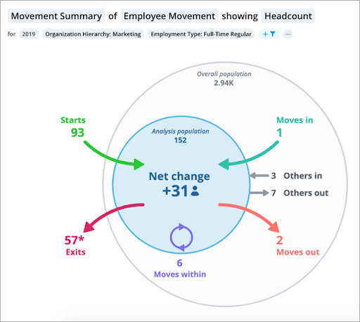

---
label:
    en: Movements (Entry, Internal & Exit)
description:
    en: This is a description...
order: 5
---

Human Resources - Workforce

## Movements - Table (Values & Sparklines)

...

## Movements - Bar Chart

...

## Movements - Stream Chart

...

## Internal Movements

...

## Movements - Waterfall Chart

...

## Net Movements

...

## Other

...

[PeopleFluent](https://www.peoplefluent.com/blog/insights/8-data-visualizations-with-peoplefluent-performance-compensation-succession/)
